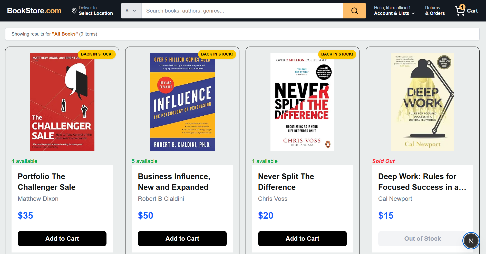
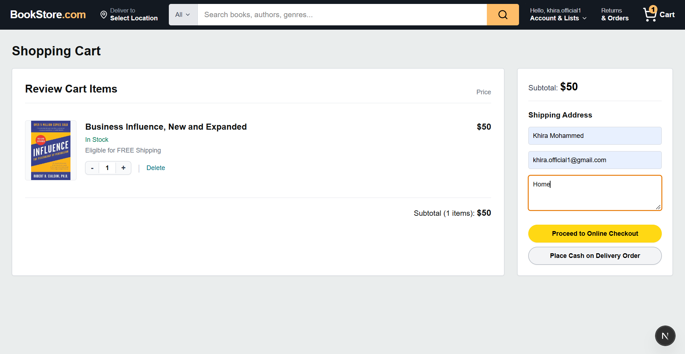
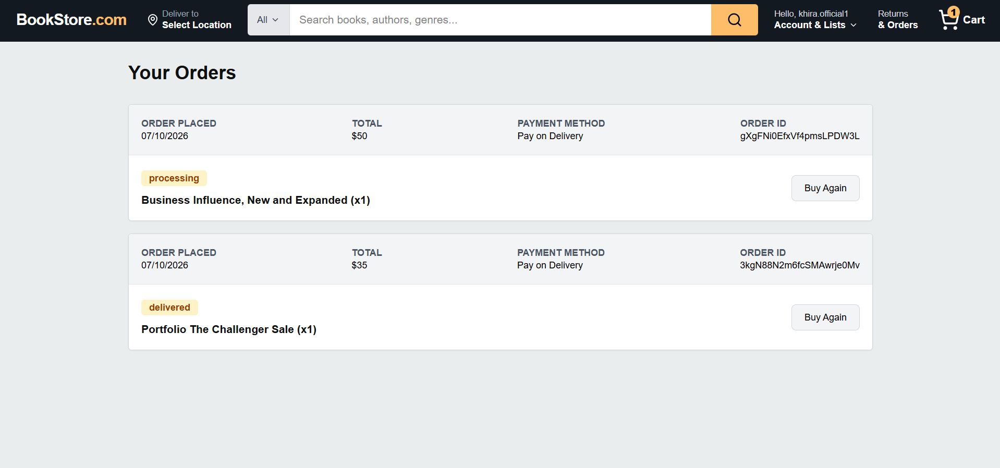
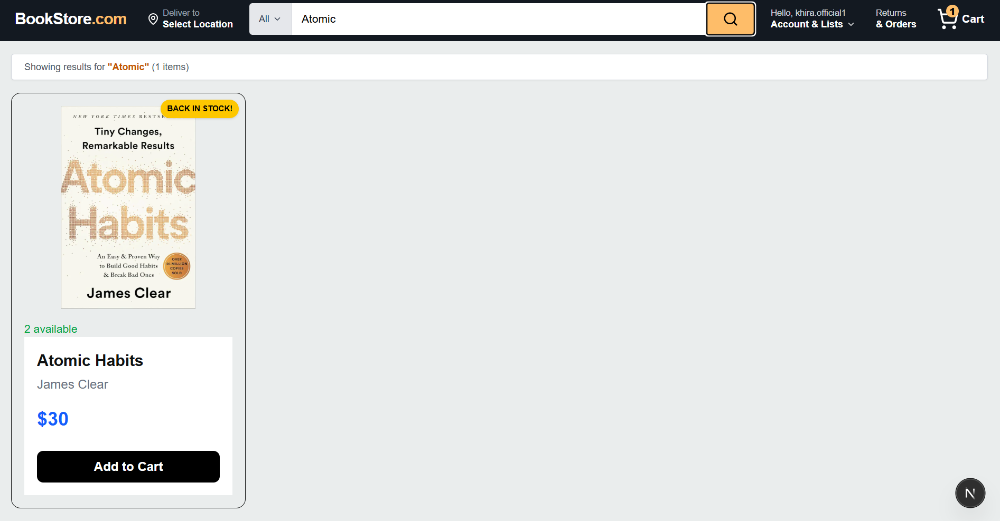
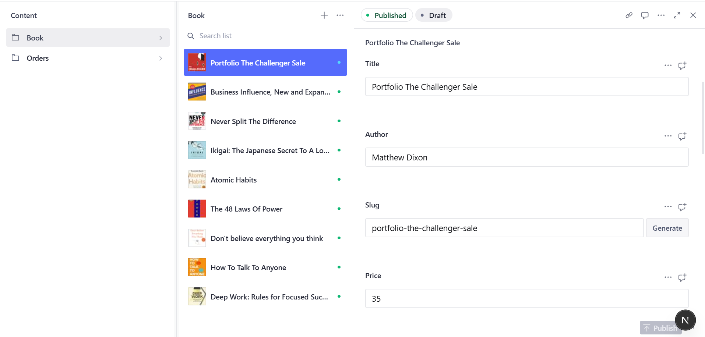
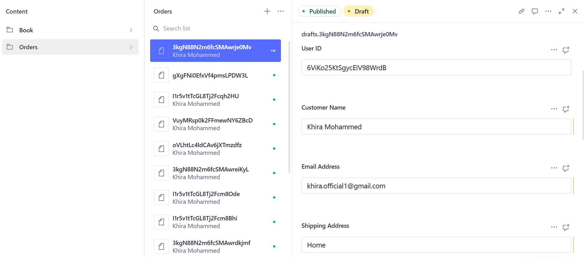

# E-commerce Website
An e-commerce website inspired by Amazon's layout and user experience, built to meet my client's requirements.

This project was a big challenge for me. Although I had a basic understanding of HTML and CSS, I still had a lot to learn about what goes on behind the scenes of a fully functional e-commerce application. Building this project pushed me beyond the frontend and gave me hands-on experience with several important web development concepts.

# What I Learned:
- CMS & Content Management: Integrating Sanity CMS to manage website content and products.
- Admin Dashboard: Building an administrative dashboard to manage books and customer orders.
- Online Payments: Implementing online payment functionality using APIs such as Stripe.
- Email Notifications: Sending transactional emails using the Resend API.
- Full-Stack Development: Connecting the frontend with backend services to build a complete e-commerce experience.

# Built With:
- Next.js – React framework for building the application.
- Sanity – Headless CMS for managing content and products.
- Stripe – Online payment processing.
- Resend – Email delivery and notifications.

# Demo & Screenshots
## Website
### 1- Homepage

### 2- Cart Page

### 3- Orders

### 4- Search

## Admin Dashboard
### 1- Books

### 2- Orders

# Future Work
The project is built around the client's needs, so future improvements and features will depend on their requests.
